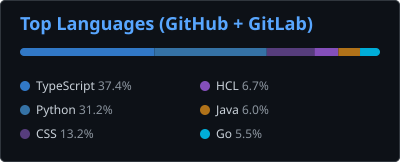

<table>
    <tr>
        <td width="55%" valign="top">

<h2><strong>Alexsandro Ocanha Rodrigues</strong></h2>

Hi! I'm Alexsandro, a software developer and technology enthusiast interested in backend development, APIs, cloud computing, and automation. I have hands-on experience with Go, Python, AWS, and Terraform, and I'm currently expanding my skills in JavaScript and TypeScript.

My goal is to build reliable, scalable software by combining software engineering with my background in IT infrastructure and cloud technologies.

Outside of coding, I enjoy exploring new technologies, building personal projects, and drinking a good cup of coffee.

## Roadmap from 2026

- [x] AWS Certified Solutions Architect – Associate
- [x] FinOps Certified Practitioner
- [ ] Microsoft Certified: Azure Administrator Associate (AZ-104)
- [ ] Certified Kubernetes Administrator (CKA)

 
</td>

<td width="45%" valign="top">

<h2 align="center"><strong>GitHub Stats</strong></h2>

    

 
<h2 align="center"><strong>Stack & Technologies</strong></h2>

    

 
</td>
    </tr>
</table>

### Connect with me

&nbsp;

&nbsp;

